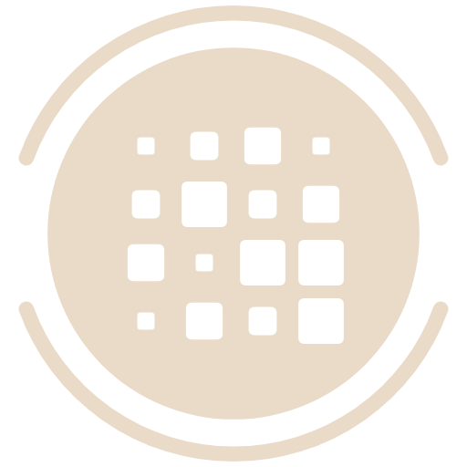
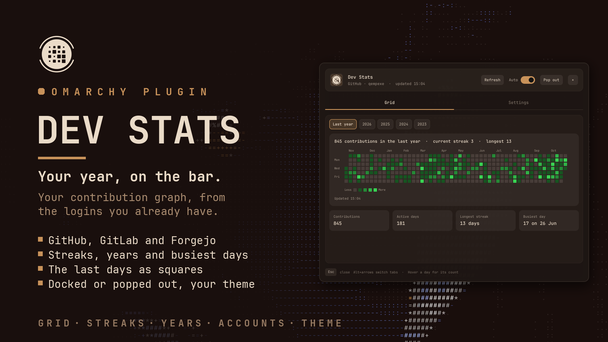
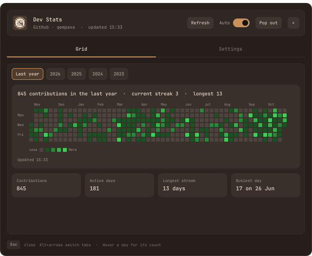
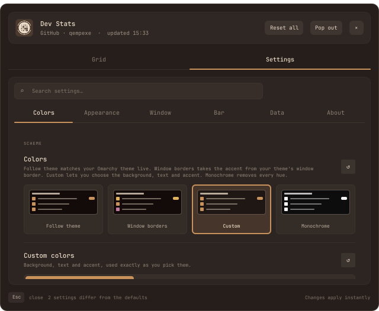
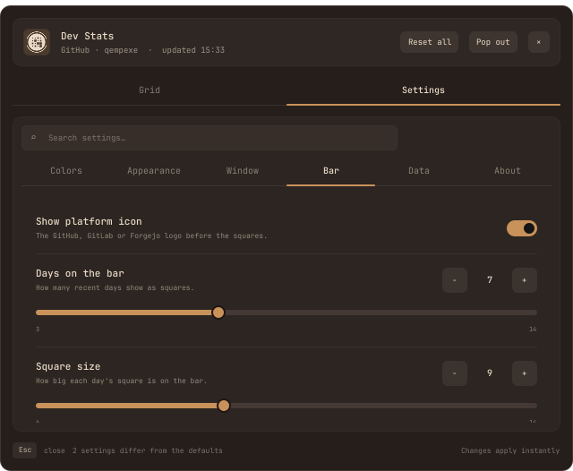
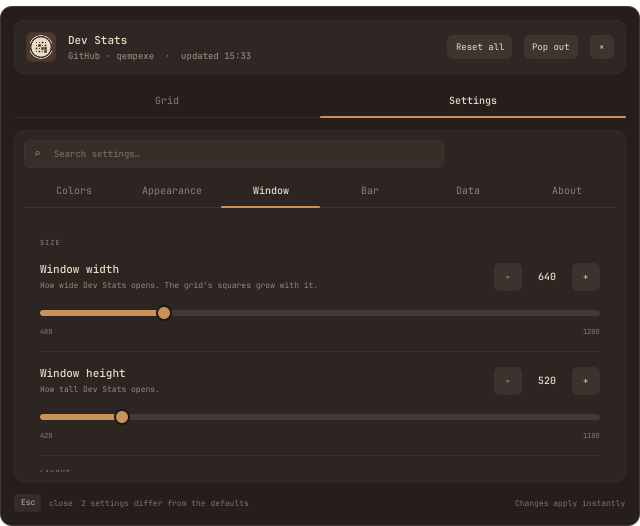
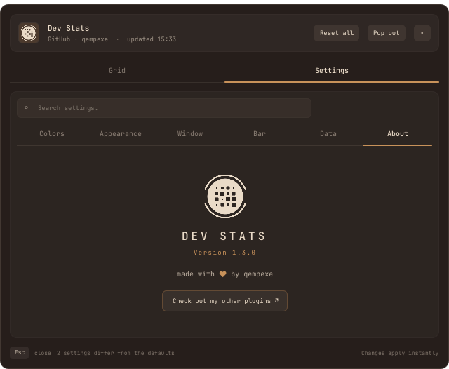

<p align="center">
  <picture>
    <source media="(prefers-color-scheme: light)" srcset="assets/logo-dark.png">
    
  </picture>
</p>

<h1 align="center">Dev Stats</h1>

<p align="center">Your contribution graph in the <a href="https://omarchy.org">Omarchy</a> bar, for GitHub, GitLab and Forgejo.</p>



The last days of your contribution graph sit on the bar as small squares, darker on quiet
days and brighter on busy ones. Click them and the whole year opens, with your streaks,
every calendar year and the busiest day. It uses the logins you already have in `gh`,
`glab`, `tea` or `fj`, and opens docked to the bar or as a window of its own.

## Features

- **Three platforms**: GitHub (and GitHub Enterprise), GitLab (and self-hosted GitLab),
  and Forgejo, Gitea or Codeberg.
- **Your existing logins**: accounts are found from the platform's own CLI. No tokens to
  paste, and none are read.
- **On the bar**: the last 3 to 14 days as squares, with the platform's logo.
- **The whole year**: the grid, the last year or any calendar year, streaks, and the
  numbers under it.
- **Your theme**: follows your Omarchy theme live, takes your window border's colors,
  or uses your own colors exactly, or none at all. The grid has its own color.
- **Docked or popped out**: a panel on the bar, or a window you can move, resize and tile.
- **Made to fit**: card style, spacing, roundness, text size, window size, outline,
  tint and opacity, and the squares on the bar, all in a searchable Settings tab.

### The grid



One column per week, Sunday on top, five shades of your grid color. Hover a day for its
count. The chips above switch between the last year and each calendar year the platform
knows about, and between your accounts when you have more than one.

Under the grid: your contributions, the days you were active, the longest streak and the
busiest day. **Refresh** in the header fetches new numbers, and the **Auto** switch next
to it turns refreshing in the background on and off.

<br clear="right">

## Installation

```bash
omarchy plugin add https://github.com/qempexe/omarchy-dev-stats.git --enable --yes
omarchy restart shell
```

Then add **Dev Stats** to your bar, from the bar settings or with
`{ "id": "io.github.qempexe.dev-stats" }` under `bar` → `layout` in
`~/.config/omarchy/shell.json`.

It needs `bash`, `jq` and `curl`, which Omarchy has, plus the CLI of each platform you
use, logged in once from a terminal:

| Platform | Log in | Where the numbers come from |
| --- | --- | --- |
| GitHub / GitHub Enterprise | `gh auth login` | the GraphQL contribution calendar |
| GitLab / self-hosted GitLab | `glab auth login` | your activity events, counted per day |
| Forgejo / Gitea / Codeberg | `tea login add` or `fj auth login` | the instance's public heatmap |

Only the CLIs of the platforms you use are needed.

## Usage

### Bar button

| Click | Does |
| --- | --- |
| Left | opens Dev Stats on the Grid tab, or closes it (or *Refresh*, or nothing: see **Left click**) |
| Middle | refreshes (or opens Dev Stats, or nothing: see **Middle click**) |
| Right | the Settings tab |

**Esc** or **×** closes it, and **Alt+←/→** switches tabs.

### Pop out and dock

The header's **Pop out** turns Dev Stats into a real window you can move, resize and
tile, and **Dock** puts it back on the bar. **Settings › Window › Open as** picks which one
the bar button opens.

Hyprland tiles new windows. To float and center the popped-out window, add to
`~/.config/hypr/hyprland.lua`:

```lua
o.window({ class = "^org\\.quickshell$", title = "^Dev Stats$" }, { tag = "+dev-stats-window" })
o.window({ tag = "dev-stats-window" }, { float = true })
o.window({ tag = "dev-stats-window" }, { center = true })
o.window({ tag = "dev-stats-window" }, { size = { 640, 520 } })
```

### Accounts

Accounts are found from your CLI logins. To add one by hand, or to follow a public
profile, create `~/.config/dev-stats/accounts.json`:

```json
[
  { "provider": "forgejo", "host": "codeberg.org", "user": "yourname" },
  { "provider": "gitlab",  "host": "gitlab.example.com", "user": "yourname" }
]
```

`provider` is `github`, `gitlab` or `forgejo` (`gitea` works too).

## Configuration

The **Settings** tab, or a right click on the bar button. Everything applies at once and
is saved in `~/.local/state/omarchy-dev-stats/settings.json`.

<table>
<tr>
<td></td>
<td></td>
</tr>
<tr>
<td></td>
<td></td>
</tr>
</table>

The settings sit in tabs, with a search box above them that looks through every tab.
Each row has a **↺** to put it back, and **Reset all** in the header puts back everything.

| Tab | Setting | Default | |
| --- | --- | --- | --- |
| Colors | Colors | Follow theme | Follow theme, Window borders, Custom or Monochrome |
| | Custom colors | | background, text and accent, a swatch or a hex code, used exactly as you pick them |
| | Text | Always readable | or Theme, or My text color |
| | Grid color | `#39d353` | the busiest days; quieter days are darker shades of it |
| Appearance | Card style | Soft | Soft, Outline or Flat |
| | Spacing | Comfortable | Compact, Comfortable or Spacious |
| | Roundness | 4 | 0 (square) to 20, for the window and the grid's squares |
| | Text size | 1 | 0.8 to 1.5 |
| | Show streaks, the legend, the numbers | on | what the Grid tab shows |
| Window | Window width, height | 640 × 520 | 480 to 1200, 420 to 1100 |
| | Open as | Bar panel | or Own window |
| | Window outline | off | the edge in your window border's colors, as a gradient or one color |
| | Window tint | 0 | 0 to 30, the accent washed over the background |
| | Window opacity | 97 | 50 to 100 |
| Bar | Show platform icon | on | |
| | Days on the bar | 7 | 3 to 14 |
| | Square size, roundness | 9, 2 | 6 to 14, 0 (square) to 7 (dots) |
| | Left click, middle click | Open Dev Stats, Refresh | or Refresh, Open Dev Stats, Nothing |
| Data | Refresh automatically | on | every 30 minutes (5 to 240) |

**Window borders** and the outline read the active border from your theme's
`hyprland.lua` (or `hyprland.conf`), and only take `#rrggbb` colors and an angle from it.
Settings saved by 1.2 keep working, and the grid color saved by 1.1 is moved over once.

**About**, the last tab, has the logo, the version and a link to more plugins.

## Troubleshooting

- **No accounts.** Log in with the platform's CLI in a terminal (see Installation), then
  press **Refresh**. If an account still isn't found, add it to `accounts.json`.
- **Request failed.** Check the CLI's login (`gh auth status`, `glab auth status`), that
  the profile is public on Forgejo/Gitea, and the network.
- **Years.** GitHub offers every year your account was active. GitLab offers the last
  three calendar years, as long as its events API keeps them. Forgejo and Gitea only give
  the last year, so no year chips appear for them.
- **GitLab numbers** are your activity events counted per day, since GitLab has no
  calendar API. They can differ a little from GitLab's own graph.
- **Forgejo and Gitea** are read over HTTPS only. Private profiles and plain HTTP
  instances aren't supported.
- **Privacy.** The QML makes no network requests. Fetching happens in `bin/dev-stats.sh`,
  which runs your own `gh`, `glab` and `curl` as you. Tokens are never read, printed or
  stored: only host and account names are taken from the CLI configs, and they are checked
  before they reach a command line. Results are kept in memory only.
- **Files.** The only file written is `settings.json`, in a folder only you can open
  (0700).
- **Text fields.** The search and hex fields never read the clipboard by themselves.
  **Ctrl+V** (or **Shift+Insert**) pastes once through `wl-paste`, at most 1 KB.
- **Something else.** Check `qs log` for `dev-stats` lines, and open an issue.

## Contributing

Bug reports and ideas are welcome as [issues](https://github.com/qempexe/omarchy-dev-stats/issues).
[CONTRIBUTING.md](CONTRIBUTING.md) explains how to add a setting or a platform, the rules
and the tests. Everyone taking part is expected to follow the
[code of conduct](CODE_OF_CONDUCT.md). What changed in each version is in the
[changelog](CHANGELOG.md).

### Source layout

```
qml/
├── BarWidget.qml     the bar squares and clicks, fetching and holding the results,
│                     docking and popping out, the theme's border, the capped paste
├── core/             UiState (colors, spacing, the open tab), SettingsStore (saved
│                     locally, applied at once)
├── panel/            Panel (docked), PopoutWindow, StatsView (the window), GridPage,
│                     SettingsView + SettingRow + TileArt, AboutPage
├── controls/         Btn, Chip, Sw, Txt, PasteInput (a text field with a bounded paste)
└── js/               Schema.js (every setting), Stats.js (the grid and streaks, and
                      cleaning what comes in), Theme.js (border colors)
bin/dev-stats.sh      account discovery and fetching
assets/               the logo, light and dark
tools/gen-manifest.js node tools/gen-manifest.js
tests/test_model.js   node tests/test_model.js
```

### Upgrading and uninstalling

```bash
omarchy plugin update io.github.qempexe.dev-stats
omarchy restart shell
```

```bash
omarchy plugin remove io.github.qempexe.dev-stats
omarchy restart shell
rm -rf ~/.local/state/omarchy-dev-stats ~/.config/dev-stats   # settings, your accounts.json
```

## License and credits

[MIT](LICENSE).

- The numbers come from **GitHub**, **GitLab**, **Forgejo** and **Gitea**, through their own
  command-line tools: [gh](https://cli.github.com), [glab](https://gitlab.com/gitlab-org/cli),
  [tea](https://gitea.com/gitea/tea) and [forgejo-cli](https://codeberg.org/Cyborus/forgejo-cli).
- Thanks to the **Omarchy** project for the shell and its plugin system, and to **Quickshell** and **Qt** for the toolkit.
- Thanks to everyone who tests it and reports issues.

Dev Stats is an independent community plugin. It is not affiliated with or endorsed by
GitHub, GitLab, Forgejo, Gitea, Codeberg or Omarchy. Their names are trademarks of their
owners and are used only to describe what the plugin connects to.
